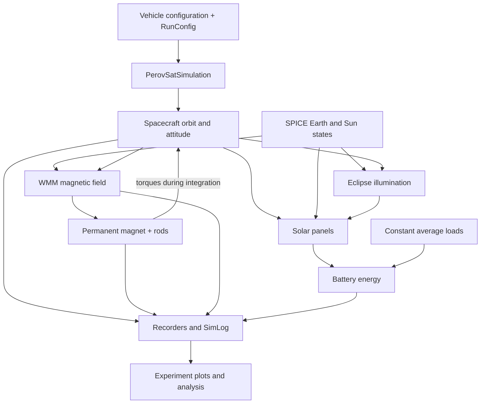

# How the simulation works

[Documentation index](../README.md)

## Read the code in this order

| File or directory | Responsibility |
| --- | --- |
| [experiments/power/run.py](../experiments/power/run.py) | A complete experiment selecting settings and plotting output |
| [perovsat/run_config.py](../perovsat/run_config.py) | Execution settings and validation |
| [perovsat/realtime.py](../perovsat/realtime.py) | Native clock pacing and timing statistics |
| [perovsat/vizard.py](../perovsat/vizard.py) | TCP listener readiness before the native Vizard handshake |
| [perovsat/config.py](../perovsat/config.py) | Hardware, initial defaults, orbit and material values |
| [perovsat/simulation.py](../perovsat/simulation.py) | Build, execute, validate recordings, write summary |
| [perovsat/environment.py](../perovsat/environment.py) | Gravity, initial orbit, SPICE, WMM and eclipses |
| [perovsat/pmac.py](../perovsat/pmac.py) | Attach permanent magnet and eight hysteresis rods |
| [perovsat/power.py](../perovsat/power.py) | Connect panels, constant sinks and battery |
| [perovsat/log.py](../perovsat/log.py) | Typed recorder containers and experiment-facing NumPy views |
| [experiments/plotting.py](../experiments/plotting.py) | Shared plotting functions |
| [ExternalModules/](../ExternalModules) | Active C++ models and SWIG interfaces |
| [messages/](../messages) | Custom hysteresis debug payload |
| [python/perovsat_plugins/](../python/perovsat_plugins) | Initialization for the compiled plugin package |
| [tests/](../tests) | Configuration/logging regressions and short integration test |
| [experimental/](../experimental) | Unfinished designs, excluded from the active build |

## Build and execution

Basilisk is the simulation framework. SPICE supplies planetary positions and
orientations; WMM (World Magnetic Model) supplies Earth's magnetic field.
PMAC means passive magnetic attitude control.

The host Makefile launches a Linux container with the checkout mounted at
`/workspace/basilisk-simulation`. The image provides Basilisk and the compiler
toolchain. An editable plugin build uses `pyproject.toml`, CMake and `bsk-sdk`
to compile custom models and generate Python/message bindings. SWIG is the
bridge that makes C++ classes callable from Python.

`PerovSatSimulation.run()` validates configuration, builds a Basilisk process
and task, initializes it, executes to the stop time, validates recordings, and
writes `summary.txt`. The instance retains references to the integrator and
subsystem wrappers: Basilisk holds C++ pointers to those objects, so dropping
their Python owners can invalidate the pointers.

Live runs finish building models, then probe the configured Vizard listener on
TCP 5556 before calling `InitializeSimulation()`. Each probe socket is closed;
Basilisk establishes its own ZeroMQ connection. This avoids starting the native
connection while Vizard is absent. Listener readiness is not a protocol or rendering
check. Initialization and connection setup are outside the paced interval; the
real-time model runs last on each task tick. Readiness timeouts and interruptions
write a failed-run summary. Native handshake and stream calls can still block.

The task is assembled in this order: spacecraft; SPICE, WMM and eclipse;
permanent magnet and rods; panels and loads; battery. Recorders are added as
messages become available, all with the selected recording period.

Arrows describe dependencies, not continuous evaluation or a guarantee that all
values represent the same solver substage.

## Time, units and frames

| Quantity | Convention |
| --- | --- |
| Task period (`timestep_s`) | Interval between scheduled module updates |
| Recording period (`record_period_s`) | Requested sample interval; recorders execute on task ticks |
| Solver steps | Adaptive RKF45 stages inside propagation, distinct from the task period |
| Timestamps | Nanoseconds internally; `SimLog` exposes seconds |
| `N` | Inertial frame; environment uses an Earth-centered origin |
| `B` | Spacecraft body frame |
| `sigma_BN` | Modified Rodrigues parameters (MRPs): dimensionless attitude, not Euler angles |
| `omega_BN_B` / `omega_B` | Body rate relative to inertial, expressed in body frame, rad/s |
| Magnetic field | Tesla; WMM provides an inertial-frame vector |
| Magnetic dipole | A·m² in body frame |
| Torque | N·m in body frame |
| Rod field `H` and magnetization `M` | A/m |
| Panel area / battery energy | m² / joules; configured battery capacity is Wh |

Choose a recording period that is a multiple of the task period for easy
interpretation. Recording faster does not make scheduled models update faster.
An adaptive integrator does not remove the need to check task-period sensitivity.

## Model assumptions

The initial orbit uses ISS-like classical elements. The environment adds Earth
and Sun gravity, SPICE planetary states, Basilisk's standard WMM magnetic field,
and Earth eclipse illumination.

The permanent magnet applies `m × B`. Each rod integrates the Flatley–Henretty
hysteresis model using substituted flux state `S`, then recovers magnetization
and torque. Material parameters are effective installed values, with
demagnetization folded in. Attitude follows the integrator stage, while the
inertial WMM field is held between scheduled updates. Rod field rate combines
an inertial finite difference with body rotation. See the
[rod equations](../ExternalModules/hysteresisRods/README.md).

The active vehicle has three fixed panels, one battery, and constant
duty-averaged loads. It does not resolve device switching or load spikes,
implement power modes or active attitude control, or add drag and solar
radiation pressure effectors. See [power](power.md) for electrical details.

`SimLog.validate()` checks required fields, sample shapes/counts, finite values,
matching timestamps and paired rod channels. It detects recording problems;
it does not validate physics. Before using results for design decisions,
compare representative runs at finer task periods and assess sensitivity to
uncertain material and load values.
